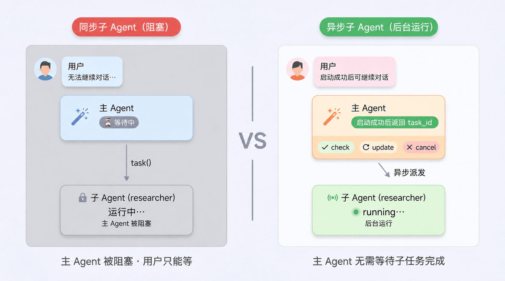
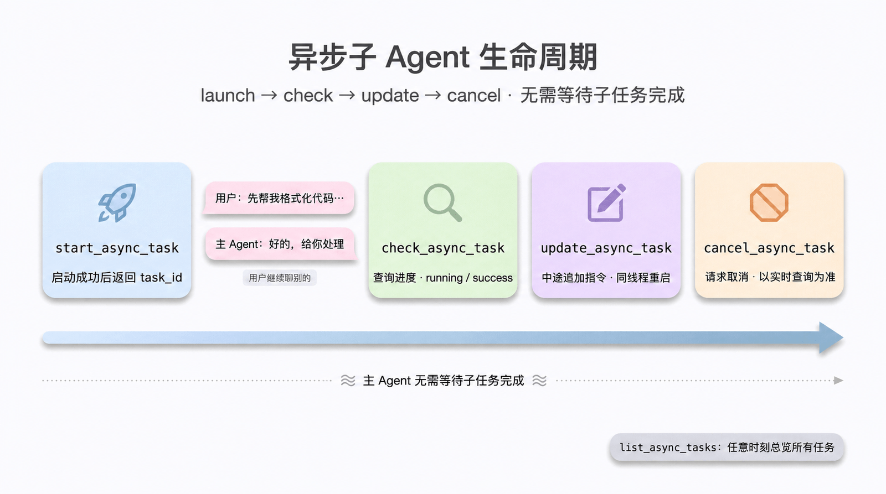

# 第 6 章：异步子 Agent — 让主 Agent 同时驱动多个子任务

> 上一章我们学习了同步子 Agent，主 Agent 通过 `task` 工具委派、然后**等待**子 Agent 跑完。但是，当子任务要花上几分钟、甚至几十分钟时，主 Agent 在用户面前就成了“死机状态”——既无法继续聊，也无法插话调整方向。本章学习 Deep Agents 0.5.0 的预览特性：**Async Subagent（异步子 Agent）**——主 Agent 立即拿到任务 ID 就返回，子 Agent 在后台继续跑；用户可以随时问进度、追加要求，甚至中途取消。

> ⚠️ **前置环境与运行模型变化**
>
> Async Subagent 是 `deepagents>=0.5.0` 的**预览特性**（preview），仍在迭代中，API 可能变化。与前几章直接在 Python 进程中调用 `agent.invoke()` 不同，本章示例需要运行在支持 Agent Protocol 的 LangGraph 服务环境中。开始前需要理解四个要素：
>
> - 用 `langgraph.json` 注册主 Agent 和异步子 Agent；
> - `AsyncSubAgent.graph_id` 必须与配置中的 graph 名称一致；
> - 用 `langgraph dev` 启动本地 Agent Server；
> - 为并行任务预留足够的 worker slots（`--n-jobs-per-worker`）。
>
> 起步时不需要远程部署：本章后面会给出“本地单部署 + ASGI”的完整最小示例。

可从仓库根目录顺序执行配套的 [第 6 章 Notebook](https://github.com/datawhalechina/deepagents-in-action/blob/main/notebooks/ch06/01-async-subagent-lifecycle.ipynb)：它会自行启动并清理本地 Agent Server，验证五个异步工具的真实调用与状态变化。

## 同步子 Agent 的瓶颈

回顾上一章的多子 Agent 协作模式：

```python
# 主 Agent 调用同步子 Agent
# 模型发出的工具调用示意，不是直接可运行的 Python 函数
# task(subagent_type="researcher", description="深入调研 LangGraph 生态")
# 此时主 Agent 在等待——可能要等 60 秒、120 秒，甚至更久
# 用户只能盯着对话框转圈
```

同步子 Agent 在两类场景下会让用户体验非常糟糕：

1. **长程任务**：如深度调研、大规模代码迁移、批量数据处理，子 Agent 工作时间从分钟级到小时级；
2. **可交互任务**：用户在子 Agent 跑到一半时，发现需要补充约束（"换个数据源再来一次"、"加上 2024 年的数据"），但同步模式下根本插不进去。

更糟的是——同步子 Agent 在被主 Agent `task()` 调用期间，**主 Agent 自己也被阻塞**。这意味着：在子 Agent 完成之前，用户无法和主 Agent 继续聊别的话题。

异步子 Agent 解决的就是这两件事：**不阻塞主线对话**，**支持中途控制**。

## 同步 vs 异步：六个维度的对比

| 维度 | 同步子 Agent | 异步子 Agent |
|---|---|---|
| **执行模型** | 阻塞——主 Agent 等到完成才能继续 | 非阻塞——立即返回任务 ID |
| **并发性** | 可并行触发，但主 Agent 仍被整批阻塞 | 完全并行，主 Agent 全程不阻塞 |
| **中途追加指令** | `task` 没有专用更新工具 | ✅ `update_async_task` 注入新指令 |
| **取消** | `task` 没有专用取消工具；宿主仍可取消整次运行 | ✅ `cancel_async_task` 请求取消任务 |
| **状态性** | 无状态——每次调用相互独立 | 有状态——子 Agent 拥有自己的会话（thread），会话历史持续累积 |
| **典型场景** | 一问一答、毫秒级到秒级的快速委派 | 几分钟以上的研究、编码、迁移等长程任务，需要在对话中互动管理 |



简单的判定法则：**子任务能在 5 秒内完成**，用同步；**子任务可能跑数分钟以上、且过程需要可交互**，上异步。

## 配置异步子 Agent

### 先分清协议、运行服务与追踪

异步子 Agent 需要由服务端承接后台任务。这里涉及几个不同层次的概念：

| 名称 | 本章中的职责 |
|---|---|
| [Agent Protocol](https://github.com/langchain-ai/agent-protocol) | 一套调用 Agent 的 API 规范，约定如何创建会话、启动运行、查询状态和取消任务等 |
| [Agent Server](https://docs.langchain.com/langsmith/agent-server) | 实现这些接口的运行服务，加载 Agent 代码，调度执行并管理会话状态与结果 |
| LangSmith Deployment | 部署和运行 Agent Server 的平台能力；也可以使用自托管的兼容服务 |
| [LangSmith Observability](https://docs.langchain.com/langsmith/observability) | 采集和查看 trace，帮助分析模型调用、工具执行、耗时与错误 |

主 Agent 负责决定任务怎么拆、交给谁、如何整合结果；Agent Server 负责承接和执行任务。开启 LangSmith 追踪会记录执行过程，但不会自动把本地 Agent 变成可接收任务的服务。本章使用 `langgraph dev` 启动本地 Agent Server，无需先部署到 LangSmith 云端。

服务端的 **thread 表示保存消息和状态的会话，不是操作系统线程**；**run 表示该会话上的一次执行**。主 Agent 调用 `start_async_task` 后，中间件通过 SDK 创建子任务的 thread 和 run，返回任务 ID，服务端继续执行子 Agent。后续查询、追加指令和取消也通过服务接口完成。

### 声明要调用的子 Agent

`AsyncSubAgent` 是一份配置，指定要调用哪个服务中的哪个 Agent：`graph_id` 标识服务端已注册的 graph 或 assistant，`url` 指定服务地址。**多个子 Agent 可以共用同一个 Agent Server**；与主 Agent 同部署时可省略 `url`，使用进程内 ASGI 传输。具体传输与部署方式见后文，也可参考[官方异步子 Agent 文档](https://docs.langchain.com/oss/python/deepagents/async-subagents)。

下面是声明配置的**示意片段**，省略了服务端 `researcher`、`coder` 的实现、注册和启动过程。`AsyncSubAgent(...)` 本身不会创建这些 Agent 的实现或启动服务器：

```python
from deepagents import AsyncSubAgent, create_deep_agent

async_subagents = [
    AsyncSubAgent(
        name="researcher",
        description="深度研究 Agent，用于多次搜索 + 信息综合的调研任务",
        graph_id="researcher",
        # 不传 url → 使用 ASGI 进程内传输（与主 Agent 同部署在一个 server）
    ),
    AsyncSubAgent(
        name="coder",
        description="编码 Agent，用于代码生成、改写与代码评审",
        graph_id="coder",
        # url="https://coder-deployment.langsmith.dev"   # 可选：远程 HTTP 传输
    ),
]

agent = create_deep_agent(
    model="google_genai:gemini-3.5-flash",
    subagents=async_subagents,
)
```

### 字段一览

| 字段 | 必填 | 说明 |
|---|---|---|
| `name` | ✅ | 唯一标识，主 Agent 启动任务时用它指定子 Agent |
| `description` | ✅ | 能力描述，主 Agent 据此决定何时把任务委派给它 |
| `graph_id` | ✅ | Agent Protocol 服务上的 graph / assistant ID；LangGraph 部署需在 `langgraph.json` 中注册 |
| `url` | 可选 | 不填走进程内 ASGI 传输；填了走远程 HTTP 传输 |
| `headers` | 可选 | 远程模式下的自定义 HTTP 头，用于自托管服务的鉴权 |

如果是 LangGraph 部署，所有 graph 写在同一份 `langgraph.json` 中，就构成"同部署"形态。

## 主 Agent 的 5 把"遥控器"

声明 `AsyncSubAgent` 后，[`AsyncSubAgentMiddleware`](https://reference.langchain.com/python/deepagents/middleware/async_subagents/AsyncSubAgentMiddleware) 会自动给主 Agent 注入 5 个工具——把它们当成主 Agent 操控后台子任务的"遥控器"：

| 工具 | 作用 | 返回 |
|---|---|---|
| `start_async_task` | 启动一个新的后台任务 | 任务 ID（立即返回） |
| `check_async_task` | 查询任务当前状态与结果 | 状态 + 结果（若完成） |
| `update_async_task` | 给运行中的任务追加新指令 | 确认 + 更新后状态 |
| `cancel_async_task` | 终止运行中的任务 | 确认信息 |
| `list_async_tasks` | 列出所有任务（含实时状态） | 任务总览 |

主 Agent 像调用普通工具一样调用它们，中间件通过 SDK 请求服务端创建会话、管理运行，并在主 Agent 的状态中记录任务元数据；子 Agent 的会话状态与执行结果由服务端管理。

### 一次完整生命周期

把这 5 个工具串起来，就是一段标准对话：

```
用户：帮我深入调研一下 LangGraph 多 Agent 架构。
主 Agent → start_async_task(description="调研 LangGraph 多 Agent 架构", subagent_type="researcher")
           → 返回 task_id: abc-123
主 Agent ← 「已经派 researcher 在后台开干，任务 ID：abc-123，
            你可以继续问别的，也可以随时让我查进度。」

用户：先帮我把这段 Python 代码格式化一下。
主 Agent ← （直接处理，researcher 仍在后台跑）

用户：刚才那个调研有进展吗？
主 Agent → check_async_task("abc-123")
           ← status: running
主 Agent ← 「任务仍在运行，当前查询没有返回具体步骤或预计完成时间。」

用户：补一下：重点关注 supervisor / network / hierarchical 这三种拓扑。
主 Agent → update_async_task("abc-123", "重点关注三种拓扑：supervisor / network / hierarchical")
           ← 已注入新指令

用户：算了，先停一下。
主 Agent → cancel_async_task("abc-123")
           ← cancelled
```



如果把视角换成三泳道的时序图，可以更清晰地看到三方之间的消息流——用户、主 Agent 与 Agent Protocol 服务之间，请求与返回（实线 / 虚线）一来一回，中间是用户继续聊天的"非阻塞区"：


以下行为按 [Deep Agents 0.7.10 异步中间件源码](https://github.com/langchain-ai/deepagents/blob/deepagents%3D%3D0.7.10/libs/deepagents/deepagents/middleware/async_subagents.py)核对。`check_async_task` 在运行中只返回状态和线程 ID，不提供步骤级进展或 ETA；若产品需要这些信息，应额外设计进度状态与读取接口。

### 5 个工具底层做了什么

理解每个工具的实际行为，能帮你写出更合理的提示词：

- **`start_async_task`（launch）**：在 Agent Protocol 服务上**新建一个 thread**、启动一次 run，把任务描述作为输入；返回 thread ID 作为 task ID。主 Agent 拿到 ID 就回到对话循环，**不会轮询等待**。
- **`check_async_task`（check）**：读取 run 的当前状态。若已完成，再读 thread state 拿到子 Agent 的最终输出；若仍在跑，直接告诉用户"运行中"。
- **`update_async_task`（update）**：在**同一 thread** 上以 `interrupt` 多任务策略发起一次新 run——前一次 run 被打断，子 Agent 带着完整对话历史 + 新指令重新启动。任务 ID 保持不变。
- **`cancel_async_task`（cancel）**：调用 `runs.cancel()` 终止远程 run，并把本地任务标记为 `"cancelled"`。
- **`list_async_tasks`（list）**：遍历所有跟踪中的任务。已结束（success / error / cancelled / timeout / interrupted）的从缓存返回；未结束的向服务端拉取实时状态（异步实现会并发查询）。查询失败时会回退到缓存状态。

## 任务元数据为何要单开一个 channel？

主 Agent 的 graph state 中专门有一个 `async_tasks` 通道，独立于消息历史，存放每个任务的：task ID、子 Agent 名、thread ID、run ID、状态、`created_at`、`last_checked_at`、`last_updated_at`。

为什么不直接放在工具消息里？因为 Deep Agents 的上下文一旦逼近上限会**自动压缩对话历史**（参见第 3 章的上下文工程）。如果任务 ID 只活在某条 ToolMessage 里，压缩后就丢了——主 Agent 会瞬间"忘了"自己派出去的所有任务，再也无法 check 或 cancel。

把元数据搬到独立 channel 之后：消息历史可以放心被压缩、被裁剪，在主线程的状态仍可恢复时，主 Agent 能通过 `list_async_tasks` 找回该线程记录的任务；它不是跨所有线程的全局任务目录。

> 这是 Deep Agents 一贯的设计哲学：**会被截断的放消息历史，必须长存的进 state channel**——和虚拟文件系统、TodoList 是同一套思路。

## 两种传输：ASGI vs HTTP

[ASGI](https://asgi.readthedocs.io/en/latest/introduction.html)（异步服务器网关接口）规定了 **Python Web 服务器怎样把请求交给应用、应用怎样交回响应**。例如，Uvicorn 接收 HTTP 网络请求后，就可以按 ASGI 约定调用应用。因此，一次请求可以同时涉及 HTTP 和 ASGI。

本节的 **“ASGI 传输”** 指的是另一条调用路径：SDK 使用进程内适配器，直接按 ASGI 约定调用应用，省去网络收发。请求仍有方法、路径和正文，应用仍会处理对应的 HTTP API；“不走网络”指的是请求的传递方式。

```text
HTTP 传输：SDK → 网络连接 → Uvicorn → Agent Server 应用
ASGI 传输：SDK → 进程内 ASGI 适配器 → Agent Server 应用
```

### ASGI 传输（同部署，推荐起手式）

先把主 Agent 和子 Agent 注册到同一份 `langgraph.json` 中，再用 `langgraph dev` 启动服务。这样，两者就由同一个 Agent Server 承载。

在这种部署方式下，`AsyncSubAgent` 可以省略 `url`，只用 `graph_id` 指定要调用的子 Agent。LangGraph SDK 会使用 ASGI 传输调用服务接口，创建会话、调度后台任务和保存状态仍由 Server 负责。

这里的“不走网络”仅指 SDK 到 Server 的这段调用；模型 API 等外部请求仍可能使用网络。后面的本地示例会启动 Server，并从客户端通过 HTTP 调用主 Agent，再由主 Agent 通过 ASGI 委派子任务。

> **调用方式提醒**：ASGI 传输需要主 Agent 通过 `ainvoke()` 等异步入口执行，不支持同步的 `invoke()`。

ASGI 优势：

- **零网络延迟**：调用即函数调用
- **零额外鉴权配置**：本地进程互信
- **子 Agent 仍有独立的会话（thread）**，各自保存消息和状态

绝大多数项目从这里起步就够了。

### 本地最小验证方案（单部署 + ASGI，可直接复制运行）

如果你只是想先确认异步子 Agent 真的能派活后立刻返回，**不需要先上远程部署**。下面这套最小示例按 `deepagents==0.7.10` 核对，可以复制到一个空目录里运行；0.5.0 是特性引入版本，不表示后续所有预览 API 完全一致：

```text
async-subagent-demo/
├── .env
├── langgraph.json
├── requirements.txt
├── run_demo.py
└── graphs/
    ├── researcher.py
    └── supervisor.py
```

### 第 1 步：安装依赖

官方文档要求本地 Agent Server 使用 `langgraph dev` 启动，`langgraph.json` 里至少配置 `dependencies` 和 `graphs`；本地调试模式推荐安装 `langgraph-cli[inmem]`，并用 `langgraph-sdk` 调 API。按下面命令准备环境即可：

```bash
uv venv
source .venv/bin/activate
uv pip install -U "langgraph-cli[inmem]"
uv pip install -r requirements.txt
```

`requirements.txt`：

```txt
deepagents==0.7.10
langgraph
langgraph-sdk
langchain-openai
```

### 第 2 步：准备环境变量

本地 in-memory `langgraph dev` 不要求 LangSmith API Key；需要 LangSmith 追踪时再配置。模型调用仍需要你所选模型提供商的 Key。为了让示例尽量短，下面默认用 OpenAI；如果你想和前面章节保持一致，也可以直接改成硅基流动的 OpenAI 兼容接口。对于本章这种多 Agent / 中间件叠加场景，更建议用能力更强的模型；如果你只是验证最小 Demo，也可以尝试 `Qwen/Qwen2.5-7B-Instruct`。

```bash
OPENAI_API_KEY=sk-...
# LANGSMITH_API_KEY=lsv2-...  # 仅在需要追踪时设置
# 或者改用硅基流动：
# SILICONFLOW_API_KEY=your-siliconflow-key
# MODEL_NAME=zai-org/GLM-5.2
```

把模型 Key 保存到 `.env`；需要追踪时再添加 LangSmith Key：

```dotenv
OPENAI_API_KEY=sk-...
# LANGSMITH_API_KEY=lsv2-...
```

如果你要改成和第二章一致的硅基流动写法，把 `.env` 改成下面这样即可：

```dotenv
SILICONFLOW_API_KEY=your-siliconflow-key
MODEL_NAME=zai-org/GLM-5.2
```

### 第 3 步：编写 `langgraph.json`

这里的关键点有两个：

- `dependencies` 指向当前目录 `./`，因为 `requirements.txt` 在项目根目录；
- `supervisor` 和 `researcher` 同时注册到一个本地 Agent Server 中，`AsyncSubAgent` 才能用 **ASGI 进程内传输** 直接调用 `researcher`，不需要写 `url`。

```json
{
  "dependencies": ["./"],
  "graphs": {
    "supervisor": "./graphs/supervisor.py:graph",
    "researcher": "./graphs/researcher.py:graph"
  },
  "env": "./.env"
}
```

### 第 4 步：编写一个故意运行很慢的 Subagent

为了让异步效果稳定可见，我们不让 `researcher` 去调搜索 API，而是直接写一个 **固定 sleep 8 秒** 的 LangGraph。这样你每次都能观察到：

- supervisor 先立刻返回 `task_id`
- researcher 在后台继续跑
- 之后 `check_async_task` 能看到从 `running` 变成 `success`

`graphs/researcher.py`：

```python
import asyncio

from langgraph.graph import END, START, MessagesState, StateGraph


async def slow_research(state: MessagesState):
    last_human = state["messages"][-1].content if state["messages"] else "No task provided."
    await asyncio.sleep(8)
    return {
        "messages": [
            {
                "role": "ai",
                "content": (
                    "[researcher finished after 8s]\\n"
                    f"latest task: {last_human}\\n"
                    "summary: async subagents return a task ID immediately, "
                    "run in the background, and can be checked or updated later."
                ),
            }
        ]
    }


builder = StateGraph(MessagesState)
builder.add_node("slow_research", slow_research)
builder.add_edge(START, "slow_research")
builder.add_edge("slow_research", END)
graph = builder.compile()
```

### 第 5 步：创建 Supervisor

主智能体用 `create_deep_agent()` 创建，并只注册一个 `AsyncSubAgent`。最关键的是：

- `graph_id="researcher"` 必须和 `langgraph.json` 中的 `graphs` 键名一致；
- **不要写 `url`**，这样才会走 ASGI；
- 在 `system_prompt` 里明确要求：先启动异步任务并把 `task_id` 返回给用户，不要立刻轮询。

`graphs/supervisor.py`：

```python
import os

from deepagents import AsyncSubAgent, create_deep_agent


graph = create_deep_agent(
    model=os.environ.get("MODEL_NAME", "openai:gpt-4.1-mini"),
    system_prompt=(
        "You are a supervisor agent for an async-subagent demo. "
        "When the user asks for a long-running research task, you must delegate "
        "to the async subagent named researcher immediately. "
        "After calling start_async_task, return the task_id to the user and stop. "
        "Do not call check_async_task unless the user explicitly asks for progress. "
        "If the user asks to revise the background task, call update_async_task."
    ),
    subagents=[
        AsyncSubAgent(
            name="researcher",
            description=(
                "Use for any long-running background research or async demo task. "
                "This agent intentionally sleeps before returning so the async "
                "behavior is easy to observe."
            ),
            graph_id="researcher",
        )
    ]
)
```

如果你想和课程前文保持一致，可以把 `MODEL_NAME` 设成硅基流动上的模型，并把 `model=` 改成一个 `ChatOpenAI(...)` 实例：

```python
import os

from langchain_openai import ChatOpenAI

model = ChatOpenAI(
    model=os.environ.get("MODEL_NAME", "zai-org/GLM-5.2"),
    api_key=os.environ["SILICONFLOW_API_KEY"],
    base_url="https://api.siliconflow.cn/v1",
)
```

然后把上面 `create_deep_agent()` 里的 `model=os.environ.get("MODEL_NAME", "openai:gpt-4.1-mini")` 替换成 `model=model` 即可。

本例的 `graphs/supervisor.py` 用于导出 graph，供 Agent Server 加载。直接运行 `python graphs/supervisor.py` 只会创建 graph 对象，不会启动服务或发起对话；添加 `InMemorySaver` 也无法替代省略 `url` 时所需的 ASGI 服务环境。请按下面两步启动 Server，再用 SDK 调用主 Agent。`langgraph dev` 会提供持久化组件，此处不要手动传入 `checkpointer`。

### 第 6 步：启动本地 Agent Server

Worker 槽位要至少容纳 1 个 Supervisor + 1 个 Researcher 的运行。这里的演示建议直接开到 `4`：

```bash
langgraph dev --n-jobs-per-worker 4
```

这里的 `langgraph` 命令由第 1 步安装的 `langgraph-cli` 提供，`dev` 子命令封装了本地开发服务的启动过程：

```text
langgraph dev
    ↓
langgraph-cli 读取当前目录的 langgraph.json
    ↓
调用 langgraph_api.cli.run_server(...)
    ↓
通过 Uvicorn 启动本地 Agent Server
    ↓
加载配置中的 graph，接受客户端请求
```

因此，只需在 `langgraph.json` 中指定 Agent 的名称和代码位置，CLI 就能启动承载它们的服务，无需自己编写 Web 服务的启动代码。命令与配置选项可查阅 [LangGraph CLI 文档](https://docs.langchain.com/langsmith/cli)。

启动成功后，终端里应该能看到本地地址，例如：

```text
API: http://127.0.0.1:2024
```

### 第 7 步：使用 SDK 验证异步行为

下面这个脚本会在**同一个 Thread** 上连续做三件事：

1. 让 Supervisor 启动一个后台 Researcher 任务；
2. 立刻追问进度，验证它没有阻塞；
3. 再追加一个新约束，验证 `update_async_task` 可用。

`run_demo.py`：

```python
import asyncio
from pprint import pprint

from langgraph_sdk import get_client


client = get_client(url="http://127.0.0.1:2024")
assistant_id = "supervisor"


async def main():
    thread = await client.threads.create()
    thread_id = thread["thread_id"]
    print("thread_id =", thread_id)

    first = await client.runs.wait(
        thread_id,
        assistant_id,
        input={
            "messages": [
                {
                    "role": "user",
                    "content": (
                        "请把这个任务交给 researcher 异步处理："
                        "用后台任务总结 async subagent 的关键行为。"
                    ),
                }
            ]
        },
    )
    print("\\n=== first response ===")
    pprint(first)

    second = await client.runs.wait(
        thread_id,
        assistant_id,
        input={
            "messages": [
                {
                    "role": "user",
                    "content": "刚才那个后台任务现在进展如何？",
                }
            ]
        },
    )
    print("\\n=== second response ===")
    pprint(second)

    third = await client.runs.wait(
        thread_id,
        assistant_id,
        input={
            "messages": [
                {
                    "role": "user",
                    "content": "补充约束：完成时请把答案写成 3 条 bullet。",
                }
            ]
        },
    )
    print("\\n=== third response ===")
    pprint(third)


asyncio.run(main())
```

运行它：

```bash
python run_demo.py
```

### 你应该看到什么

只要出现下面这组现象，就说明这条本地 ASGI 路径已经打通了：

1. `first response` 很快返回，里面有一个后台任务 ID，而不是卡 8 秒等 `researcher` 完成。
2. `second response` 大概率会看到 `running`，或者已经拿到阶段性状态信息。
3. `third response` 不会要求你重开任务，而是会尝试更新已有后台任务。
4. 过几秒后再次问进度时，状态会从 `running` 变成 `success`，并带上 `researcher` 的最终结果。

这个示例用于观察异步机制，不是确定性的自动化测试：Supervisor 的模型延迟可能超过 8 秒，首次返回时子任务也可能已完成。固定研究图只回显最新输入，不会真的把输出改成 3 条 bullet；它验证的是新指令进入子线程，真实格式遵循需换成模型驱动的子 Agent。一旦这套最小示例跑通，你再把 `researcher` 替换成真正的深度智能体、搜索工具或远程 HTTP 子智能体，排障成本会低很多。

### HTTP 传输（远程，按需切换）

加上 `url` 字段就切换到 **HTTP 传输**，SDK 调用走网络发到远程 Agent Protocol 服务：

```python
AsyncSubAgent(
    name="researcher",
    description="Research Agent",
    graph_id="researcher",
    url="https://my-research-deployment.langsmith.dev",
)
```

LangGraph 部署的鉴权由 SDK 自动处理：从环境变量读取 `LANGSMITH_API_KEY`（或 `LANGGRAPH_API_KEY`）。自托管的 Agent Protocol 服务可能用别的鉴权方案，按需通过 `headers` 传。

**什么时候用 HTTP？**

- 子智能体需要**独立扩缩容**
- 子智能体要不一样的资源画像（GPU / 大内存）
- 子智能体由**另一个团队**维护、独立发布

## 三种部署拓扑

| 拓扑 | 形态 | 推荐场景 |
|---|---|---|
| **单部署（Single）** | 所有 Agent 同部署，全部用 ASGI | **绝大多数项目的起点**：一台服务好运维、零网络延迟 |
| **拆分部署（Split）** | 主 Agent 一台，子 Agent 一台，全用 HTTP | 子 Agent 资源画像或扩缩容策略与主 Agent 显著不同 |
| **混合（Hybrid）** | 一部分子 Agent 走 ASGI（同部署），另一部分走 HTTP（远程） | 大多数子 Agent 同部署省事，少数特殊子 Agent 单独扩 |

混合形态长这样：

```python
async_subagents = [
    AsyncSubAgent(
        name="researcher",
        description="研究 Agent",
        graph_id="researcher",
        # 不传 url → ASGI（同部署）
    ),
    AsyncSubAgent(
        name="coder",
        description="编码 Agent",
        graph_id="coder",
        url="https://coder-deployment.langsmith.dev",
        # 传了 url → HTTP（远程）
    ),
]
```

**起手式建议**：先用单部署 + ASGI，等遇到具体的扩缩容/团队边界问题再拆。

## 最佳实践

### 1. 本地开发要把 Worker Pool 调大

每个活跃的运行会占用一个 Worker 槽位。一个主 Agent 同时跑 3 个子 Agent，至少需要 4 个槽位（1 主 + 3 子）。槽位不够时，新启动的任务会**排队**。常见表现包括：`start_async_task` 长时间不返回，或虽然拿到了任务 ID，但后续 `check_async_task` 长时间看不到实质进展。

```bash
langgraph dev --n-jobs-per-worker 10
```

### 2. 描述要具体，行为导向

主 Agent 靠 `description` 决定派给谁。两个对照：

```python
# ✅ 好
AsyncSubAgent(
    name="researcher",
    description="深度网络调研，需要多次搜索 + 信息综合时使用",
    graph_id="researcher",
)

# ❌ 差
AsyncSubAgent(
    name="helper",
    description="帮你处理事情",
    graph_id="helper",
)
```

### 3. 用 Thread ID 串联追踪

LangGraph 部署里，每次异步子 Agent 运行都是一次普通的 LangGraph run。配置并启用 LangSmith 追踪后，可以在 Observability 中查看这些运行。主 Agent 的 trace 会显示 launch / check / update / cancel / list 这些工具调用；每个子 Agent 的运行是另一条 trace，**通过子任务的 thread ID（也就是 task ID）就能把两边对上**。这里使用的是追踪能力；后台任务仍由 Agent Server 执行。

## 常见问题排查

### 问题 1：刚启动就立刻轮询状态

**症状**：主 Agent 调完 `start_async_task` 立刻又调 `check_async_task`，循环往复——异步直接退化成伪同步。

**解法**：中间件本身已经在系统提示词里加了相关规则。如果模型仍然不听话，在你自己的主 Agent system_prompt 里再强化一次：

```python
agent = create_deep_agent(
    model="google_genai:gemini-3.5-flash",
    system_prompt="""...你的指令...

派出异步子 Agent 之后，**必须立刻把控制权交还给用户**；
不要在没有用户提问的情况下主动 check_async_task。""",
    subagents=async_subagents,
)
```

### 问题 2：报告了一个过时的状态

**症状**：用户问进度，主 Agent 直接引用对话历史里某个旧状态，没有发起新的 check。

**解法**：中间件提示词里写了"对话历史中的任务状态永远是过时的"。如果模型还是踩坑，在主 Agent 的 system_prompt 里再加上一条："回答任务进度前，必须先调用 `check_async_task` 或 `list_async_tasks`"。

### 问题 3：任务 ID 被截断或改写

**症状**：模型把 `abc-123-def-456-...` 缩写成 `abc-123` 或 `abc...`，导致 check / cancel 找不到任务。

**解法**：中间件已经要求模型使用完整 task ID。如果某个模型固执地截断，可以在 system_prompt 中加一条："始终使用完整的 task_id，不要截断、不要缩写、不要改写"，或者换个更听话的模型。

### 问题 4：启动子 Agent 长时间不返回

**症状**：`start_async_task` 卡住、迟迟拿不到任务 ID，或拿到 task ID 后后续 `check_async_task` 长时间没有实质进展。

**解法**：worker pool 被打满。`langgraph dev` 启动时加上 `--n-jobs-per-worker 10`（或更大），按你预期的并发量调整。

### 部署排查清单

异步子 Agent 涉及主 Agent、子 Agent、Agent Protocol 服务和后台 run，排查时不要只看主对话窗口。建议按下面顺序检查：

| 现象 | 优先检查 | 处理方式 |
|---|---|---|
| `start_async_task` 报找不到 Agent | `graph_id` 是否与 `langgraph.json` 注册名一致 | 确认主 Agent 使用的 `graph_id` 和部署配置完全一致，尤其注意大小写和下划线 |
| 远程 HTTP 子 Agent 调用失败 | `url`、`headers`、`LANGSMITH_API_KEY` / `LANGGRAPH_API_KEY` | LangSmith 部署优先依赖环境变量；自托管服务则把鉴权头显式放进 `headers` |
| 本地同部署能跑，远程拆分后失败 | 子 Agent 服务是否兼容 Agent Protocol | 先用 SDK 直接访问远程服务创建 thread / run，再接回 `AsyncSubAgent` |
| 任务一直 `running` | worker 数、外部工具超时、子 Agent 是否卡在长工具调用 | 提高 `--n-jobs-per-worker`，给外部 API / 搜索 / 代码执行设置超时，避免后台 run 永久占住 worker |
| `cancel_async_task` 后状态不立刻变化 | 服务端取消是异步生效 | 用 `check_async_task` 再查服务端 run；`list_async_tasks` 会直接复用本地 `cancelled` 缓存，不能用它证明服务端已停止。取消也不会撤销已经发生的外部副作用 |
| 主 Agent 查不到之前的任务 | thread / checkpoint 是否持久化 | 确保主 Agent 配置 checkpointer；任务元数据依赖 `async_tasks` channel，进程重启后需要可恢复状态 |
| LangSmith 中 trace 对不上 | task ID、thread ID、run ID 是否记录完整 | 保留完整 task ID；用 thread ID 串联主 Agent 的 launch 工具调用和子 Agent 的实际 run |

## 参考实现

LangChain 官方提供了一个完整可跑的示例仓库：[async-deep-agents](https://github.com/langchain-ai/async-deep-agents)，Python 与 TypeScript 双版本，演示了一个主 Agent + researcher + coder 子 Agent 的部署形态，配套部署到 LangSmith Deployments。读完本章后，强烈建议把这个仓库 clone 下来跑一遍，亲眼看看主 Agent "派活之后立刻能继续聊"的实际效果。

## 小结

本章我们解锁了 Deep Agents 0.5.0 的预览特性 Async Subagent：

1. **核心动机**：突破同步子 Agent 的两个瓶颈——**主 Agent 不再被阻塞**，**任务可以中途追加指令或取消**。
2. **5 把遥控器**：`start` / `check` / `update` / `cancel` / `list`，主 Agent 像调普通工具一样用它们操控后台子任务。
3. **状态独立通道**：任务元数据存在 `async_tasks` channel 中，与消息历史解耦——消息压缩不会删除任务元数据；跨调用和重启恢复仍依赖主线程的持久化。
4. **两种传输**：默认 ASGI（同部署、零延迟），按需切换 HTTP（远程、可独立扩缩容）。
5. **三种拓扑**：单部署 / 拆分部署 / 混合，**起手用单部署**，按工程需要再拆。
6. **避坑要点**：worker pool 要足够、描述要具体、永远基于实时 `check` 而非对话历史报告状态。

下一章我们将学习 Skills——可复用的 Agent 能力包，让 Agent 获得领域专属的多步骤工作流与知识模板。
